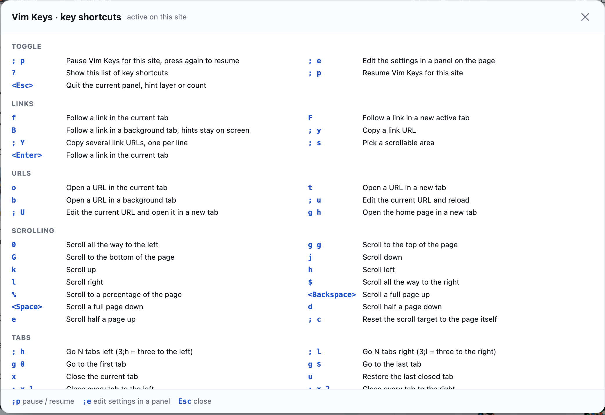
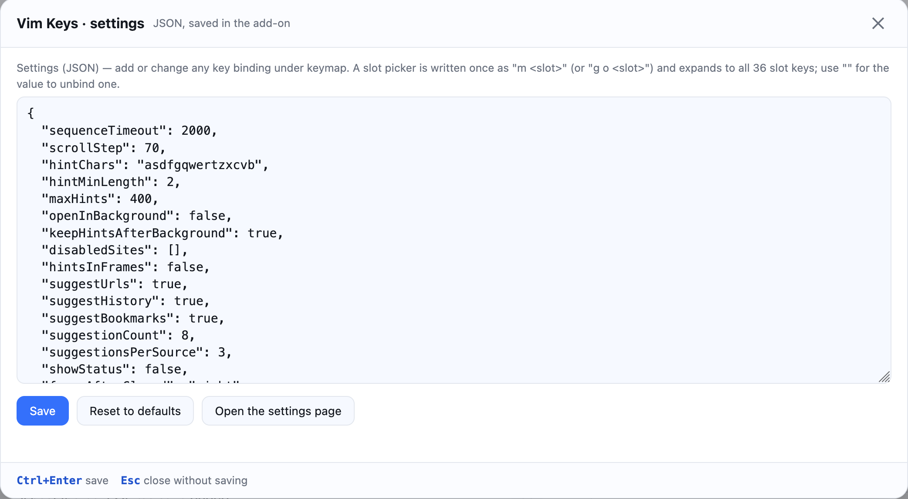
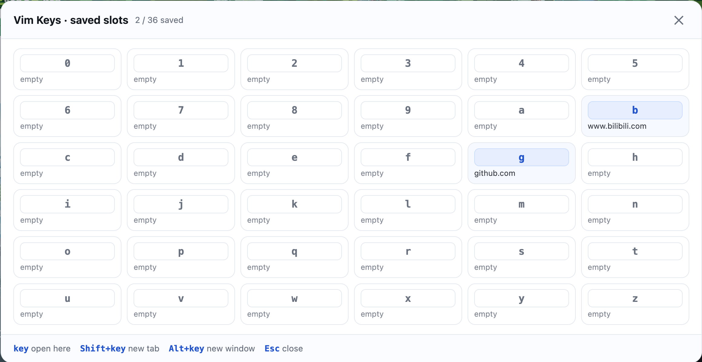

# Vim Keys

用 Vim 的方式控制 Firefox：提示跳转链接、输入网址、滚动、切换标签，并保留
Quick Sites 的 36 个快捷站点槽位。

谨以此纪念 Vimperator。

## 安装

[**在 addons.mozilla.org 安装 Vim Keys**](https://addons.mozilla.org/en-US/firefox/addon/vimkeys/)

需要 Firefox 140+（Android 142+）。安装后按 `?` 即可查看全部快捷键，无需配置，也无需账号。

## 截图

## 功能

Vim Keys 给 Firefox 加上了 Vim 风格的键盘层，并保留了 Quick Sites 的 36 个快捷站点槽位。

按 f 为页面上所有链接标上短提示，输入提示即可在当前标签打开；F 在新的活动标签打开；B 在后台标签打开并保留提示，可以连续打开多个链接。提示至少两个字符，已经输入的字符会变灰，剩下的字符更醒目。

o 和 t 打开输入面板，输入网址（或搜索词）。输入时会从已保存的槽位、书签、打开的标签和浏览历史里建议网址，每一行都标注来源；上下键选择，Enter 打开，Tab 补全，Ctrl+Enter 在后台标签打开。

j/k/h/l、gg、G、d/e、Space、Backspace、0、$、50% 按 Vim 的习惯滚动页面，支持数字前缀。;h/;l 切换标签并支持数字（3;l 往右跳三个），g0/g$ 跳到首尾，x 关闭，u 恢复。r 重新加载，, 和 . 前进后退。yy 复制当前网址，yl 复制标题，;y 复制提示所指链接的网址，V 高亮光标所在行、y w 复制它。/ 在页内查找，* 查找光标下的词，n/N 在匹配间跳转。

所有快捷键都能自定义：设置页、工具栏弹窗，或在页面上按 ;e 直接编辑 JSON；按键表自相冲突时扩展会拒绝保存。;p 可以在当前站点暂停全部快捷键并记住这个设置，适合自带键盘快捷键的网页应用。按 ? 可以查看由当前按键表实时生成的全部快捷键。Esc 会离开正在编辑的输入框，因此一打开就聚焦搜索框的页面也能直接使用。

快捷站点槽位保留了 Quick Sites 的全部功能：m 加槽位键保存页面，g o / g t / g b / g w 加槽位键分别在当前标签、新活动标签、后台标签、新窗口打开，g l 列出全部 36 个槽位。列表可以导出和导入 JSON 文件，五个前缀可以作为一个整体改名。

## 按键

| Keys | What it does |
| --- | --- |
| `f` / `F` / `B` | Label the links: open in this tab, a new active tab, or a background tab that keeps the hints on screen |
| `o` / `t` / `b` | Type a URL or a search, with suggestions from slots, bookmarks, tabs and history, in this / a new / a background tab |
| `j` `k` `h` `l` `gg` `G` `d` `e` `<Space>` `<Backspace>` `0` `$` `%` | Scroll, with Vim counts (`3j`, `50%`) |
| `;h` / `;l` | Step through tabs, with a count (`3;l`) |
| `g0` / `g$` / `x` / `u` | First / last tab, close, restore |
| `yy` / `yl` / `;y` | Copy the page URL, the title, or a link URL from a hint |
| `V` then `y w` | Highlight the line under the cursor and copy it |
| `/` `*` `n` `N` | Find in the page, find the word under the cursor, next / previous match |
| `?` | Every shortcut, generated from the live keymap |
| `;e` | Edit the settings, including every key binding, in a panel on the page |
| `;p` | Pause Vim Keys on the current site, and remember it |
| `m` + key | Save the current page into one of the 36 quick-site slots |
| `g o` / `g t` / `g b` / `g w` + key | Open a slot in this tab, a new tab, a background tab, or a new window |
| `g l` | The list of saved slots |

Every shortcut can be rebound, and a keymap that conflicts with itself is
refused. A count works wherever it makes sense: `10j`, `3<Space>`, `5%`, `3;l`.

在任意页面按 `?` 查看完整且实时的按键表。

## 一处浏览器限制

Firefox 不允许任何扩展在 `addons.mozilla.org`（包括本扩展自己的页面）、
`accounts.firefox.com`、`support.mozilla.org` 等 Mozilla 站点，以及
`about:addons`、`about:debugging`、`view-source:`、PDF 阅读器等特权页面上运行
内容脚本。Vim Keys 在这些页面上不会生效；这是浏览器的安全限制，任何扩展都无法绕过。
从 AMO 安装完成后，请打开任意普通网页再使用。

## 链接

- 扩展主页：https://addons.mozilla.org/en-US/firefox/addon/vimkeys/
- 问题反馈：https://github.com/lylehust/Vim-Keys/issues
